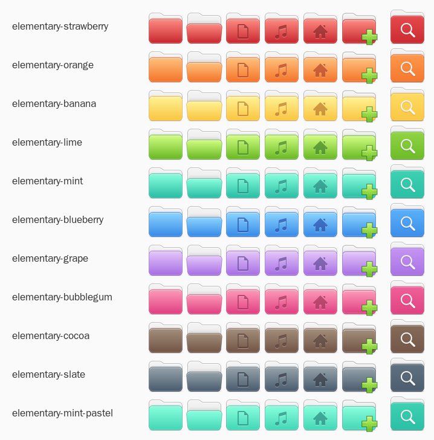

# elementary-accent-folders

Make the folder icons of **elementary OS** follow your **accent color**.

Pick Grape in System Settings and your folders turn purple. Pick Mint and they turn mint. This also works with the *Automatic* accent, which follows the wallpaper. Only the folders change color (plus the Files app icon); every other icon stays exactly as elementary designed it.



## Features

- **Follows the accent color live.** When you change the accent in *System Settings → Desktop → Appearance*, the folders update immediately, including with the wallpaper-based *Automatic* accent.
- **Uses the official elementary palette**: Strawberry, Orange, Banana, Lime, Mint, Blueberry, Grape, Bubblegum, Cocoa and Slate. The **Latte** accent keeps the original manila folders.
- **Lightweight variants.** Each color is a tiny theme that contains only the recolored folders and inherits everything else from `elementary`. Updates to the official icon theme flow through automatically.
- **Built from your installed icons.** Variants are generated from `/usr/share/icons/elementary`, and are rebuilt by themselves when the `elementary-icon-theme` package updates.
- **Recolors the Files icon too**, including in the Applications Menu and the dock.
- **Leaves your choices alone.** If you pick a different icon theme (Papirus, for example), the script will not override it.
- **Has no dependencies.** It is one Python 3 file and uses `gsettings` to listen for changes, with no polling.

## Requirements

- elementary OS 8 (developed and tested there)
- Python 3.9 or newer, and `gsettings`. Both are preinstalled on elementary OS.

## Install

```bash
git clone https://github.com/maylton/elementary-accent-folders.git
cd elementary-accent-folders
./elementary-accent-folders --install-autostart
```

This does four things:

1. copies the script to `~/.local/bin/elementary-accent-folders`;
2. generates the 10 color variants in `~/.local/share/icons`;
3. adds an autostart entry so the watcher runs at every login;
4. starts the watcher right away.

Nothing is installed system-wide and no `sudo` is needed.

The first time, restart the panel once so the Applications Menu picks up the new icons:

```bash
killall io.elementary.wingpanel   # the panel comes back by itself after about a second
```

## Usage

```bash
elementary-accent-folders --status               # detected accent, active theme, watcher state
elementary-accent-folders --sync                 # apply the matching color once, without a watcher
elementary-accent-folders --apply grape          # use a fixed color instead of following the accent
elementary-accent-folders grape mint             # only generate some variants
elementary-accent-folders --pastel --install-autostart   # lighter, softer shades
elementary-accent-folders --uninstall-autostart  # stop following the accent
elementary-accent-folders --remove               # undo everything and restore the default
```

If `~/.local/bin` is not in your `PATH`, call it as `~/.local/bin/elementary-accent-folders`.

The watcher log is at `~/.cache/elementary-accent-folders.log`.

### Fixed color without the script

Every [release](../../releases) includes a tarball with all 10 variants already built:

```bash
mkdir -p ~/.local/share/icons
tar -xzf elementary-accent-folders-prebuilt.tar.gz -C ~/.local/share/icons
gsettings set org.gnome.desktop.interface icon-theme 'elementary-grape'
```

## How it works

### Detecting the accent

`io.elementary.settings-daemon` stores the selected accent in `org.gnome.desktop.interface gtk-theme` as `io.elementary.stylesheet.<color>`. In *Automatic* mode the daemon computes the color from the wallpaper and writes the result to that same key. The watcher listens to the key with `gsettings monitor` and switches `org.gnome.desktop.interface icon-theme` to the matching variant.

### Recoloring

The original folders use five manila shades. Each shade is mapped to a step of the elementary palette. The mapping is the same one elementary's designers use for the purple *Saved Search* folder (Latte → Grape). The Files app icon is blue (Blueberry) and is recolored shade by shade.

Recolored icons:

- every folder in *Places*: generic, open, Documents, Downloads, Music, Pictures, Videos, Templates, Public, Remote, Recent, Home, Desktop, and their aliases such as `inode-directory` and `*-drag-accept`;
- action icons that draw a folder: `folder-new`, `folder-copy`, `folder-move`, `document-open`, `document-save-as`;
- the Files app icon (`system-file-manager`).

These are left untouched: symbolic (monochrome) icons, the purple Saved Search folder and tags.

### The Applications Menu (wingpanel)

Wingpanel hard-codes its icon theme (`gtk_icon_theme_name = "elementary"`) and ignores the system setting, so the Applications Menu never sees the variants on its own.

To work around this, the script creates `~/.local/share/icons/elementary`, which holds a copy of the original `index.theme` and symlinks to the recolored directories of the active color. GTK 3 merges this user directory with `/usr/share/icons/elementary` and gives the user copy priority. As a result, only the folders and the Files icon change, and every other icon still comes from the system theme.

The directory is tagged with `X-AccentFolders-Overlay=true`, and the script never touches a `~/.local/share/icons/elementary` that lacks that tag. It is deleted when you switch to Latte or run `--remove`.

## Troubleshooting

- **The Applications Menu still shows the old color.** Run `killall io.elementary.wingpanel` once. The panel restarts by itself.
- **Nothing changes.** Check `elementary-accent-folders --status`. If *icon theme* shows something other than `elementary` or `elementary-<color>`, you chose another theme and the script respects that choice. Set it back with `gsettings set org.gnome.desktop.interface icon-theme elementary`.
- **After a system update.** The variants are rebuilt automatically the next time the accent changes or the watcher starts.

## Uninstall

```bash
elementary-accent-folders --remove
```

This stops the watcher, removes the autostart entry, the script in `~/.local/bin`, the variants and the panel overlay, and sets the icon theme back to `elementary`.

## Credits and license

The icons are derived from [elementary/icons](https://github.com/elementary/icons) by elementary, Inc. and contributors, licensed under GPL-3.0. Colors come from the [elementary color palette](https://elementary.io/brand#color).

This project is licensed under the [GNU General Public License v3.0 or later](LICENSE).

This is a community project and is not affiliated with or endorsed by elementary, Inc.
